# b"Hello" | b"Halo..." 👋

You can call me Heru or Hez. I am an evolutionary biologist working at the intersection of field biology, genomics, phenomics, on-device deep learning, and software. I work on high-performance, memory-efficient tools that scale from mobile devices and personal computers to [HPC clusters](https://en.wikipedia.org/wiki/High-performance_computing). I develop evolutionary biology software that resembles everyday apps. That means it must install with a single click through the official app stores, while still offering single-command installation for command-line experts. I develop DevOps strategies to simplify cross-platform software deployment.

For more insights into my work and adventures, visit [my website](https://hhandika.com/)!

<!-- START_SECTION:github-stats -->

  <picture>
    <source media="(prefers-color-scheme: dark)" srcset="assets/overview-dark.svg" />
    
  </picture>
  <picture>
    <source media="(prefers-color-scheme: dark)" srcset="assets/languages-dark.svg" />
    
  </picture>

  <picture>
    <source media="(prefers-color-scheme: dark)" srcset="assets/activity-dark.svg" />
    
  </picture>

  <picture>
    <source media="(prefers-color-scheme: dark)" srcset="assets/top_repos-dark.svg" />
    
  </picture>

Stats reflect public repositories only (84 of 84 repositories counted). Updates daily • Latest update: October 28, 2026

<!-- END_SECTION:github-stats -->
